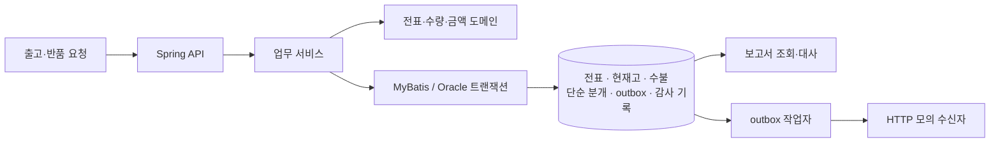

# Java Inventory Reliability | 출고·반품과 재고 정합성

동시 출고와 요청 재시도, 외부 전달 중 장애가 발생해도 **전표·재고·수불·단순 분개가 어떻게 함께 남고 복구되는지** 다룬 백엔드 개인 프로젝트입니다. Java와 Oracle을 사용해 출고·부분 반품을 구현하고, 동시성 제어부터 장애 복구와 보고서 조회까지 검증했습니다.

화면을 만드는 대신 업무 규칙과 데이터 신뢰성에 집중했습니다. 외부 시스템은 모의 수신자이며 운영 서비스나 실제 ERP 연동은 아닙니다.

## 프로젝트 요약

| 항목 | 내용 |
| --- | --- |
| 문제 | 여러 요청이 같은 재고를 읽거나 응답 유실 뒤 재시도하면 초과 출고, 중복 전표, 내부·외부 반영 누락이 생길 수 있습니다. |
| 업무 범위 | 출고, 원출고를 참조하는 부분 반품, 현재고·수불과 단순 매출·채권 분개, 보고서 조회 |
| 설계 | 도메인 객체로 업무 규칙을 표현하고, Oracle 트랜잭션·행 잠금·요청 키·outbox로 동시성과 실패 경계를 다룹니다. |
| 대표 결과 | 가상 수불 10만 행에서 보고서 SQL의 후보 인덱스 적용 전후 p95 **0.840ms → 0.453ms, 46.1% 감소**. 별도 컨테이너 재현에서는 **38.4% 감소**했습니다. |
| 기술 | Java 21, Spring Boot, MyBatis, Oracle Free, Maven, Docker Compose |

결과는 로컬 격리 환경의 가상 데이터 기준입니다. 운영 성능이나 실제 사용자의 개선 수치가 아닙니다. [전체 측정 조건과 원시 결과](RESULTS.md)

## 서버 구조



| 계층 | 책임 |
| --- | --- |
| API | 출고·반품 요청과 보고서 조회를 받습니다. 역할별 정적 토큰은 격리 개발 환경용입니다. |
| 도메인 | 출고·반품 상태, 수량과 금액 규칙을 표현합니다. |
| 업무 서비스·DB | 요청 키를 확인하고 필요한 행을 잠근 뒤 전표·재고·수불·분개·outbox를 하나의 트랜잭션에 기록합니다. |
| outbox 작업자 | 커밋된 이벤트를 별도로 전달하고, 실패나 lease 만료 시 재시도합니다. |
| 보고서·대사 | 현재고와 수불, 전표와 단순 매출·채권 분개를 조회해 비교합니다. |

출고 API는 주문 생성부터 반영까지 한 요청에서 처리합니다. 임시저장·승인을 사용자가 별도 호출하는 기능은 없습니다. 외부 전달은 DB 트랜잭션에 포함되지 않으며, 성공 여부도 업무 저장과 별개입니다.

## 핵심 설계

### 1. 동시에 출고해도 재고를 초과하지 않도록

조회 후 수량을 계산해 따로 저장하면 같은 잔고를 본 여러 요청이 모두 성공할 수 있습니다. 출고 서비스는 창고·SKU 순서로 재고 행을 잠그고 수량을 검사한 뒤 전표와 수불·현재고를 함께 반영합니다. 잠금 순서를 고정해 다품목 요청 간 잠금 순서 충돌을 줄입니다.

도메인의 수량 검사는 잘못된 입력을 막고, DB 잠금과 제약은 요청 간 경쟁을 다룹니다. 이 보호는 **같은 잠금 규약에 참여하는 writer**에 한정됩니다. [출고 처리 코드](src/main/java/com/inventory/application/OraclePostingService.java) · [DB 접근 코드](src/main/java/com/inventory/oracle/OracleInventoryMapper.java)

### 2. 반품과 역분개를 원출고에 연결

기존 기록을 지우는 대신 원출고를 참조하는 반품 전표를 만들고 재고를 되돌립니다. 원출고를 잠가 누적 반품 수량을 제한하고, 원금액을 기준으로 매출·채권의 반대 분개를 기록합니다. 단일 통화, 세금·수금 없는 단순 회계 범위입니다. [반품 도메인](src/main/java/com/inventory/domain/ReturnDocument.java) · [금액 모델](src/main/java/com/inventory/domain/Money.java)

### 3. 내부 처리와 외부 전달을 분리

요청 키와 입력 fingerprint로 같은 요청의 재시도를 식별합니다. 같은 키에 다른 입력이 오면 충돌로 처리합니다. 업무 데이터와 outbox를 함께 커밋하고, 작업자는 이벤트를 선점해 모의 수신자에 전달합니다. 전달 후 응답이 유실되면 재전송될 수 있으므로 **수신자의 이벤트 ID 멱등 처리**가 중복 반영을 막아야 합니다. 무조건적인 exactly-once 보장은 아닙니다. [요청 식별](src/main/java/com/inventory/application/RequestFingerprint.java) · [outbox 작업자](src/main/java/com/inventory/oracle/OracleOutboxProcessor.java)

## 검증 결과

아래는 로컬 Oracle Free와 가상 데이터로 수행한 검증입니다. 각 테스트의 입력과 확인 범위는 링크에서 볼 수 있습니다.

| 검증 | 조건과 결과 |
| --- | --- |
| 동시 출고 | 재고 60개에 요청 100건: **60건 확정, 40건 재고 부족 거절** |
| 중복 요청 | 같은 요청 키로 동시 요청 40건: **전표 1건** |
| 동시 부분 반품 | 출고 3개에 반품 요청 20건: **3건 확정, 17건 거절** |
| 트랜잭션 롤백 | 출고 12개·반품 11개의 선택된 저장 경계에 실패를 주입해 롤백과 같은 요청의 재시도 확인 |
| 작업자 장애 복구 | 외부 모의 수신 직후 실제 작업자 JVM을 종료하고 재시작: 독립 환경 2곳에서 각 3회 모두 **전송 2회, 모의 반영 1회, 최종 SENT** |

[출고·반품 통합 테스트](src/test/java/com/inventory/oracle/OraclePostingIntegrationTest.java) · [작업자 강제 종료 실험](src/test/java/com/inventory/oracle/OracleWorkerCrashExperimentTest.java) · [장애 복구 원시 결과](evidence/oracle-worker-crash-102ff297-9699-4487-892e-d6540238290d.json) · [별도 환경 재현](evidence/oracle-worker-crash-248a8bae-403a-407a-ad65-8a728d958063.json)

작업자 실험의 복구 관찰 시간은 첫 환경에서 약 6.5~6.6초였습니다. 5초 lease 대기와 새 JVM 시작이 포함된 3회 관찰값이며, 운영 복구 시간 분포나 SLO가 아닙니다. 재시작은 실험에서 직접 수행했습니다.

### 보고서 SQL 개선 전후

실제 [`OracleReportMapper.stock`](src/main/java/com/inventory/report/OracleReportMapper.java) SQL로 100개 SKU의 가상 수불 10만 행 중 한 SKU를 조회했습니다. 기존 인덱스 상태와 후보 인덱스 `(warehouse_id, sku, quantity_delta)`를 추가한 상태에서 각 30회 준비 실행 후 300회 측정했습니다. 매 호출 현재고와 수불이 모두 999인지 확인했으며 접근 경로 힌트는 사용하지 않았습니다.

| 측정값 | 추가 전 | 후보 인덱스 추가 후 | 변화 |
| --- | ---: | ---: | ---: |
| 조회 p50 | 0.608ms | 0.393ms | 35.3% 감소 |
| 조회 p95 | 0.840ms | 0.453ms | 46.1% 감소 |
| 실제 실행 커서의 마지막 1회 버퍼 접근 | 58 | 20 | 38 감소 |

별도 새 컨테이너에서 같은 입력으로 반복했을 때 p95는 **0.695ms → 0.428ms, 38.4% 감소**했습니다. 각 비교는 순차 실행했고 캐시·호스트 부하는 완전히 통제하지 않았습니다. JDBC와 통계 수집 비용이 포함되며 인덱스 쓰기·저장 비용은 측정하지 않아 [후보 인덱스](src/main/resources/oracle/004_optional_stock_cover_index.sql)는 자동 적용하지 않습니다. [첫 실험 원시 결과](evidence/oracle-stock-report-8287c5c5-cbd6-491f-86b5-922bc6414d74.json) · [재현 원시 결과](evidence/oracle-stock-report-cdfe006f-208d-41f7-a3bd-69955b32663e.json)

## 실행과 재현

JDK 21과 Maven으로 기본 단위 테스트를 실행합니다.

```sh
mvn test
```

Oracle 통합 테스트와 실험은 Docker Compose, Oracle Free 컨테이너, **별도 테스트 스키마**가 필요합니다. 기본 테스트에서 Oracle 통합 테스트는 명시적으로 설정하지 않으면 건너뜁니다. 테스트는 가상 데이터를 만들고 삭제하지 않으며, 일부 outbox 테스트는 별도 빈 스키마가 필요합니다. 컨테이너 준비, 환경 변수, 각 실험의 안전 조건은 [Oracle 실행·검증 안내](docs/oracle-workflow.md)를 확인하세요.

기존 PostgreSQL 경로와 그 전후 비교 결과는 Oracle과 별도입니다. 당시 코드 및 환경과 현재 Oracle 결과를 섞지 않도록 [측정 결과](RESULTS.md)에 각각 기록했습니다.

<details>
<summary>기존 PostgreSQL 실험 실행</summary>

Docker Compose와 Python 3이 필요하며 로컬 포트 18184–18188과 별도 명명된 볼륨을 사용합니다.

```sh
docker-compose -p inventory-reliability up -d --build
# app의 http://127.0.0.1:18184/actuator/health가 UP이 될 때까지 기다립니다.
python3 experiment.py --restart-tests
python3 migration_experiment.py
python3 legacy_contract_experiment.py
python3 stock_concurrency_experiment.py
python3 mapping_experiment.py
docker-compose -p inventory-reliability --profile scale up -d app2 proxy-one proxy-two
# app2의 http://127.0.0.1:18186/actuator/health가 UP이 될 때까지 기다립니다.
python3 scale_experiment.py
docker-compose -p inventory-reliability exec -T proxy-two nginx -s reload
python3 stock_concurrency_experiment.py --multi
python3 worker_experiment.py
docker-compose -p inventory-reliability start app2
# app2의 /actuator/health가 UP이 될 때까지 기다립니다.
python3 ops_snapshot.py
docker-compose -p inventory-reliability --profile scale stop
```

`--restart-tests`는 실험용 app 컨테이너를 강제 종료하고 재시작합니다. 워커 비교는 app2를 중지하며, 스키마 실험은 격리 DB에 컬럼을 추가합니다. 반복 실행 시 데이터가 누적되고 stop 명령은 볼륨을 삭제하지 않습니다.

</details>

## 범위와 한계

- 초기 재고는 테스트에서 현재고와 수불을 함께 준비합니다. 초기재고 입력이나 전표 검색 UI, 프론트엔드는 없습니다.
- 직접 SQL 등 다른 writer의 잠금 준수, tenant 격리, 실제 외부 ERP, 완전한 회계와 운영 보안은 구현 또는 검증 범위에 없습니다.
- Oracle API의 정적 역할 토큰과 기존 PostgreSQL 실험 API는 운영 환경용 보안 체계가 아닙니다. 실제 데이터와 연결하거나 배포하지 않습니다.
- 내부와 외부 상태를 서로 다른 시점에 조회한 대사는 하나의 원자적 스냅샷을 보장하지 않습니다.

더 자세한 업무 규칙과 재현 범위는 [Oracle 구현 안내](docs/oracle-workflow.md), 설계 판단 요약은 [포트폴리오 자료](docs/portfolio-case-study.md), 진행 항목은 [개발 계획](docs/plans/inventory-reliability-roadmap.md)을 참고하세요.
